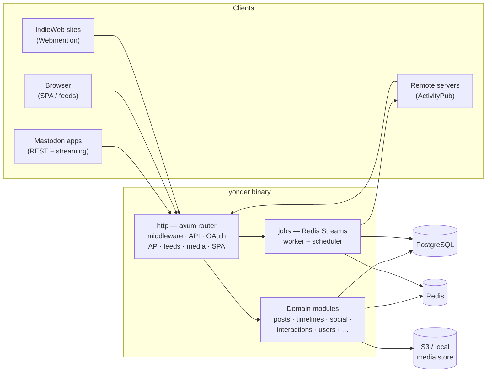
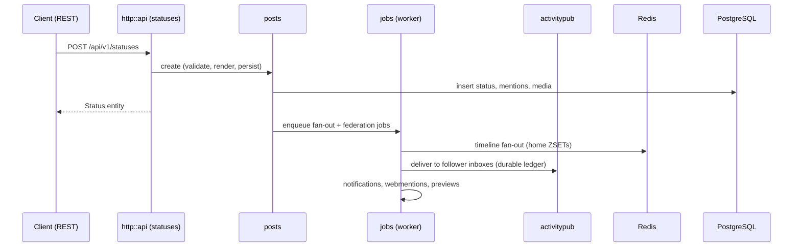
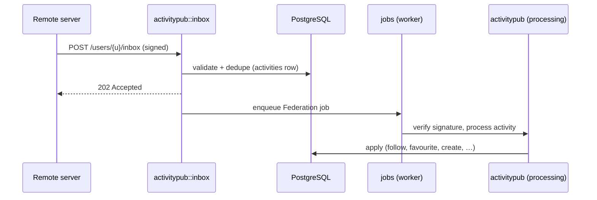

# Architecture

Yonder is a self-hosted, Mastodon-compatible ActivityPub server written in
Rust, shipped as a single binary with an embedded Vue 3 single-page
frontend. This document describes the code structure and the main
components of the service — how the packages fit together and what each
one owns. It is deliberately not an implementation deep-dive: for
developer setup, testing and release mechanics see
[development.md](development.md), and for feature-level API contracts see
the topical documents in this directory.

## The big picture

One process (or two — see [Runtime topology](#runtime-topology)) fronts
three storage systems and speaks three protocols:

- **PostgreSQL** — the source of truth for every domain entity.
- **Redis** — the job queue, the cache layer, rate-limit counters,
  streaming fan-out state and the home-timeline accelerator.
- **HTTP** — the Mastodon client API, the ActivityPub federation
  surface, RSS/Atom feeds, Webmentions, media, OAuth, API docs and the
  SPA shell, all served by one axum router.

## Runtime topology

`main.rs` is a thin shell over [`cli`](#climainrs) — the same binary
implements every subcommand (`serve`, `worker`, `migrate`, `config`,
`user`, `instance`, `run-job`, `domain-block`, `relay`, `emoji`,
`frontend`, `webpush`, `openapi`), each a thin adapter over the same
service functions the HTTP API uses.

- `yonder serve` — the HTTP server, plus an optional in-process worker
  draining the job queues.
- `yonder worker` — a standalone queue drain + scheduler, for setups
  that keep the HTTP process lean or run several workers.

Both entry points share the same `AppState` assembly: config resolution,
database pool, Redis pool, media store, job dispatcher and the
ActivityPub context. The global allocator is `mimalloc`, chosen because
glibc malloc's per-thread arenas hoard freed pages under federation
churn.

## Configuration, database and cache

| Module     | Role |
|------------|------|
| `config`   | Layered instance configuration. Priority, highest wins: database overlays (`config_overlays` table, editable from the admin panel and CLI) → `YONDER_*` environment variables (`__` as nesting separator) → `config.toml` → built-in defaults. Admin overlays are stored in the database and hot-reloaded without a restart. |
| `db`       | PostgreSQL access via `sqlx`: the pool helper and the embedded reversible migrations (`migrations/*.up.sql` / `*.down.sql`). Migrations run automatically on `serve` unless disabled; all queries are runtime-checked so builds don't need a live `DATABASE_URL`. |
| `cache`    | The shared Redis handle — an async `bb8` pool plus a namespaced cache API (`get`/`set` with TTL, pattern deletion, and single-flight `get_or_load` request coalescing). Also constructs the document store the ActivityPub layer uses. |

## HTTP layer (`http`)

`http::build_router` composes the modular router: feature epics merge
their subrouters without touching the assembly file, and the SPA file
server is registered as the **fallback** — every defined route wins by
construction, and anything unmatched lands on the frontend's
`index.html` (client-side routing). Middleware wraps the router:
request-id → tracing → CORS → routes.

Key pieces:

- **`http::api`** — the Mastodon-compatible REST API under `/api/v1`
  and `/api/v2`, one route module per feature area (statuses, timelines,
  accounts, notifications, admin…), plus `yonder.*` extension payloads
  where Mastodon defines no contract. A small `pleroma` module covers
  the Pleroma API surface clients expect.
- **`http::oauth`** — root `/oauth/*` routes: the token endpoint
  (password, client-credentials, authorization-code + PKCE,
  refresh-token and device-code grants), the consent flow behind
  `GET/POST /oauth/authorize`, the device flow, and the two-factor
  exchange endpoints. All share the `authentication` rate-limit bucket.
- **`http::ws`** — `/api/v1/streaming`, Mastodon's WebSocket streaming
  protocol (`subscribe`/`unsubscribe` over `user`, `public`,
  `public:local`, `hashtag` and `list` streams), backed by an in-process
  event bus that domain code publishes to.
- **`http::middleware`** — the `AuthContext`/`MaybeAuth` bearer-token
  extractor (also accepting `?access_token=` for streaming clients),
  Redis-backed fixed-window rate limiting (per named bucket, keyed by
  user id or client IP), client-IP resolution behind proxies, and CORS.
- **`http::frontend`** — SPA serving and content negotiation for the
  web surface: static files from the active frontend, `index.html`
  fallback for client-side routes, feed-discovery and `rel="me"` link
  injection into `<head>`, and the per-user alternative-frontend cookie.
  Protocol prefixes (`/api`, `/.well-known`, `/oauth`, `/media`,
  `/swagger-ui`) always answer like the protocol they look like — an
  unmatched `/api/…` is a JSON 404, never HTML.
- **`http::negotiate`** — dual-purpose routes pick their representation
  by `Accept`: an ActivityPub document for `application/activity+json`,
  the human page for `text/html`.
- **`http::paginate`** — Mastodon-style `max_id`/`min_id`/`limit` cursor
  pagination with `Link` headers, shared by timelines and lists.
- **`http::openapi`** — merges every API module's fragment into the
  OpenAPI 3 spec served at `/openapi.json`, with a bundled Swagger UI at
  `/swagger-ui`.

## Domain modules

Each module owns one feature area end-to-end: storage, services and the
entity shapes the API renders. The HTTP handlers stay thin and delegate
to these services, which are the same functions the CLI subcommands call.

### Identity and accounts

- **`users`** — local and remote accounts: profile loading and editing,
  account settings, relationships primitives, invites, account deletion
  and suspension, account moves, auto-follow on migration, and the
  `transfer` submodule — the account-portability pipeline (archive
  export/import, encryption, CSV parsing, remote handshakes). See
  [account-management.md](account-management.md).
- **`auth`** — registration, OAuth2 applications and grants, access and
  refresh tokens, linked sessions, the Mastodon scope model with the
  account-state gate, argon2id passwords, TOTP/backup-code two-factor
  and WebAuthn. See [authentication.md](authentication.md).
- **`emoji`** — custom emoji administration, packs, zip/filesystem
  import and read-time `:shortcode:` rendering. See [emoji.md](emoji.md).

### Content

- **`posts`** — the status lifecycle: compose, render (Markdown or plain
  text), edit, delete, mentions, polls, link previews, conversations and
  scheduled/cleanup jobs. Visibility is canonicalized to
  `public | unlisted | followers_only | direct`. With `[math] enabled`,
  LaTeX delimiters in post text are rendered to images by an external
  command and stored as ordinary media attachments (`math_source`
  marks them for edit/Update reuse). See [posting.md](posting.md).
- **`timelines`** — home, local, federated, list and tag reads. One SQL
  engine serves every scope; the home feed additionally keeps a Redis
  sorted-set index per user, filled by fan-out jobs on publish. Postgres
  is always the source of truth — the index is a first-page accelerator
  whose contents are re-validated by the same predicate, so a Redis
  outage degrades to slower queries, never wrong results. See
  [timelines.md](timelines.md).
- **`filters`** — Mastodon v2 server-side content filters: rule CRUD,
  per-context rule compilation and the `filtered` attribute on rendered
  statuses. See [filters.md](filters.md).
- **`media`** — attachment upload and processing (image variants,
  blurhash), served from local disk or S3 with identical URL shapes.
  See [media.md](media.md).
- **`search`** — accounts, statuses and hashtags behind
  `GET /api/v2/search`, with trigram-indexed matching and remote
  FQN/URL resolution. See [search.md](search.md).
- **`tags`** — hashtag lookup, follow/unfollow and trending. See
  [search.md](search.md) and [timelines.md](timelines.md).
- **`feeds`** — RSS/Atom feeds for profiles, hashtags and lists at
  Mastodon-shaped URLs (`/users/{u}.atom`, `/tags/{t}.rss`), with feed
  discovery `<link>` tags injected into the SPA pages they back. See
  [feeds.md](feeds.md).
- **`translation`** — pluggable third-party translation backends for
  `POST /api/v1/statuses/{id}/translate`.

### Social graph and interactions

- **`social`** — follows, follow requests, blocks, mutes, domain-level
  user blocks, lists, user notes, subscriptions and relationship
  counters, plus the inbound ActivityPub hook arms for `Follow`/`Block`.
  See [social-graph.md](social-graph.md).
- **`interactions`** — favourites, boosts, bookmarks, quotes, emoji
  reactions and pins, with the inbound ActivityPub activities routed
  through a single `on_activity` hook. See [interactions.md](interactions.md).
- **`notifications`** — two-stage generation: emit sites enqueue a typed
  fan-out payload, and the job handler re-checks every suppression rule
  (blocks, mutes, domain blocks, stranger-notification opt-outs) before
  inserting the deduplicated row; delivery covers the REST surface, the
  streaming bus and Web Push. See [settings.md](settings.md) for the
  user-facing controls.

### Federation

- **`activitypub`** — the federation core, built on `pubby-sdk`:
  actor resolution (instance actor + per-username actors), the Postgres
  storage adapter, document caching, inbox processing (validate →
  dedupe → enqueue → 202, with signature verification in the job),
  outbound delivery with a durable per-inbox ledger, follows, outbox,
  featured collections, lookup and the moderation hooks. See
  [instance.md](instance.md) for the operator view.
- **`webmentions`** — the IndieWeb counterpart of the mention pipeline,
  backed by `webmentions-sdk`: incoming verification (SSRF-guarded
  source fetch, backlink check, Microformats2 parse) and outgoing
  notifications, with a ledger and a public source page. See
  [webmentions.md](webmentions.md).

### Trust, safety and administration

- **`moderation`** — reports, domain blocks, user-level moderation
  actions and the append-only audit log with its retention job. See
  [moderation.md](moderation.md).
- **`admin`** — instance administration: settings overlays with
  read-only/secret/restart policies, the audit-log reader, relay
  management, the SMTP email transport and WebPush VAPID keys. See
  [admin.md](admin.md).

## Background jobs (`jobs`)

Jobs persist in **Redis Streams** so they survive process restarts.
Duplicate delivery is tolerated — handlers must be idempotent. The
module provides:

- a typed registry of job kinds, each routed to one of three queues
  (`default` / `federation` / `bulk`) mirroring the latency-vs-bulk
  trade-off;
- the worker loop (claim → execute → ack, with retry and dead-letter
  semantics);
- a cron scheduler that only *triggers* — scheduled jobs enqueue through
  the same dispatcher, so they share the queue's guarantees. Schedules
  are admin-configurable.

Nearly every asynchronous side effect in Yonder is a job: federation
delivery and inbox processing, notification fan-out, timeline fan-out,
media processing, email, Web Push, scheduled posts, account transfers
and cleanup sweeps.

## Frontend (`frontend/`)

A Vue 3 + TypeScript SPA served by the backend (or by an alternative
frontend — see below):

- **`pages/`** — one component per route (timelines, compose, profile,
  settings, admin panels, the OAuth consent page…), wired by
  **`router/`** with auth guards.
- **`stores/`** — Pinia stores for auth/session, settings, compose
  drafts, notifications, conversations, theme and the instance entity.
- **`api/`** — the typed REST client used by every store and page.
- **`components/`** — the UI kit (layout, status rendering, compose box,
  admin fields) shared across pages.
- **`i18n/`** — locale files (English, Spanish, Italian, German, Arabic).
- **`sw.ts`** — the PWA service worker: asset caching, Web Push
  subscription handling and frontend-switch invalidation (it
  unregisters itself when the backend reports a different active
  frontend).

The backend serves the SPA as the router fallback and stamps an
`x-yonder-frontend` header on every response; the anti-flash theme
bootstrap in `index.html` applies the stored theme before the bundle
paints.

### Alternative frontends

`frontends` (Rust) implements a Pleroma/Akkoma-style frontend registry:
custom frontends live as directories under `frontends.dir`, each with a
`frontend.json` manifest, and can be installed from a zip via the admin
API or CLI. The built-in `yonder` frontend always resolves, so the
server has a servable entry point even before `frontend/dist` is built.
A per-user cookie (`yonder_frontend`, written by the settings API) lets
individual users pick a different frontend from the instance default.

## Request lifecycles

### Posting a status (local write)

The HTTP response returns as soon as the row is committed; every
asynchronous side effect (federation, notifications, timeline fan-out)
happens in the job worker.

### Inbound federation (remote activity)

POST inboxes do only cheap, fast work inline and answer `202`;
signature verification and processing are durable and retried by the
worker.

### Timeline read

Home, local, federated, list and tag timelines all flow through one SQL
engine; the home timeline consults the Redis sorted-set accelerator for
its first page and re-validates every candidate id against the same
visibility predicate before rendering.

## Where to go next

- [development.md](development.md) — environment setup, migrations, the
  test harness, job-queue and HTTP internals, release pipeline.
- Feature-level API contracts: [posting.md](posting.md),
  [timelines.md](timelines.md), [social-graph.md](social-graph.md),
  [interactions.md](interactions.md), [notifications](settings.md) and
  friends — see the [docs index](.) for the full list.
- [authentication.md](authentication.md) — OAuth2, tokens, sessions,
  two-factor and the scope model.
- [admin.md](admin.md) and [instance.md](instance.md) — operating an
  instance.
